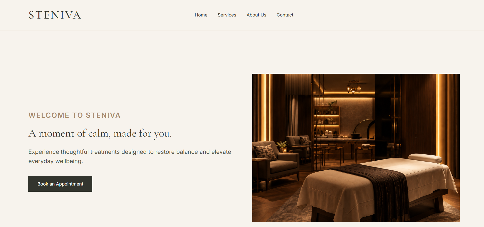
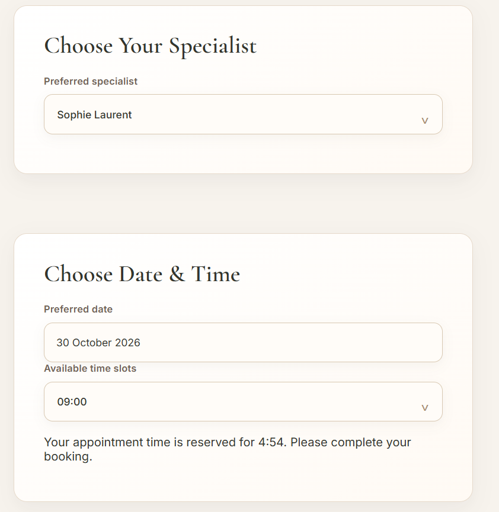
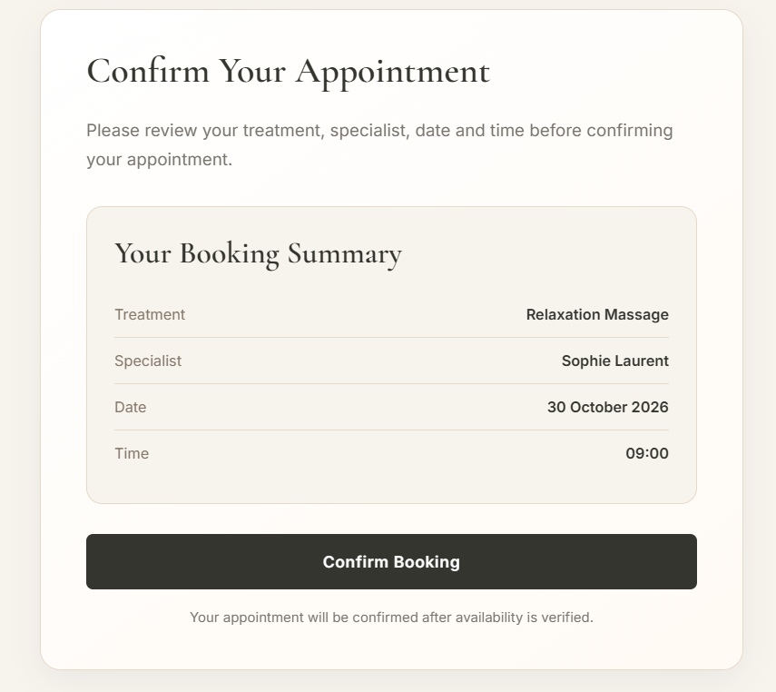
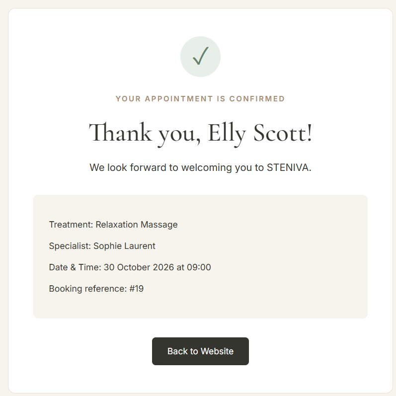
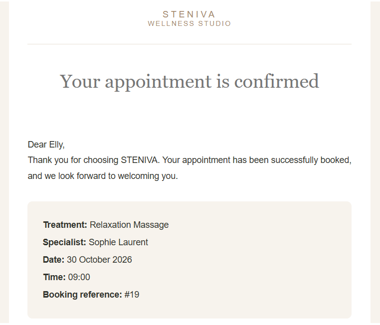
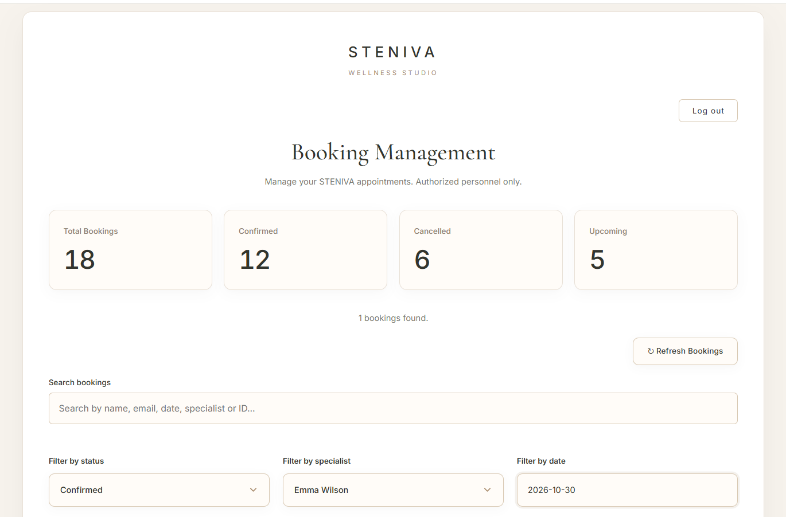

# STENIVA — Beauty & Wellness Booking System

A full-stack appointment booking web application developed for a fictional premium beauty and wellness studio.

STENIVA combines a modern, responsive interface with a Node.js backend, SQLite database, real-time appointment availability, and an administrative booking management dashboard.

**Live Demo:** https://steniva.helioho.st

## Screenshots

The following screenshots demonstrate STENIVA's user interface, appointment booking workflow, automated email notifications, and administrative features.

### 1. Homepage

The homepage introduces STENIVA and makes it easy for visitors to book an appointment.



### 2. Wellness Services

An overview of the available treatments, including service descriptions, durations, pricing, and direct booking buttons.


### 3. Appointment Date & Time Selection

Customers can select their preferred specialist, appointment date, and available time slot. A temporary five-minute reservation hold helps prevent conflicting bookings during checkout.



### 4. Booking Review

Before confirming an appointment, customers can review their selected treatment, specialist, date, and time.



### 5. Successful Booking Confirmation

After a successful reservation, the application displays a confirmation page containing the appointment details and a unique booking reference.



### 6. Automated Email Confirmation

STENIVA integrates Mailjet to automatically send booking confirmation emails containing the customer's appointment details and booking reference.



### 7. Admin Booking Dashboard

A session-protected administration dashboard for managing appointments, viewing booking statistics, searching reservations, filtering records, and cancelling appointments.




## Features

### Customer Experience
- Responsive website with a premium, minimalist design
- Three wellness treatments with dedicated descriptions and pricing
- Appointment booking with treatment, specialist, date, and time selection
- Real-time availability based on existing reservations
- Automatic prevention of overlapping appointments
- Five-minute temporary appointment holds
- Countdown timer and automatic release of expired holds
- Automatic availability updates
- Email confirmations for successful bookings

### Admin Dashboard
- Secure administrator login with session-based authentication
- Booking management dashboard
- Booking statistics and upcoming appointments
- Search and filtering by status, specialist, and date
- Appointment cancellation
- Automatic cancellation emails
- Booking status management without deleting reservation history

## Technologies

**Frontend**
- HTML5
- CSS3
- JavaScript (Vanilla JS)
- Flatpickr for date selection

**Backend**
- Node.js
- Express.js
- REST API
- SQLite with better-sqlite3

**Security and Integrations**
- bcryptjs for password verification
- express-session for administrator sessions
- express-rate-limit for request limiting
- dotenv for environment configuration
- Mailjet API for transactional emails

## How Appointment Booking Works

1. The customer selects a treatment, specialist, and appointment date.
2. The system retrieves available time slots from the backend.
3. Selecting a time creates a temporary five-minute hold.
4. Overlapping time slots become unavailable to other customers.
5. The customer completes the reservation before the hold expires.
6. The backend validates the hold and stores the confirmed booking in SQLite.
7. A confirmation email is sent to the customer.

If the temporary hold expires, the appointment time becomes available again.

## Getting Started

### Prerequisites

- Node.js and npm
- Git
- A modern web browser

### Installation

Clone the repository and install the dependencies:

```bash
git clone https://github.com/Stilyy345/steniva-booking-system.git
cd steniva-booking-system
npm ci
```

### Environment Configuration

Create a `.env` file in the project root and configure the required environment variables:

```env
SESSION_SECRET=your_session_secret
ADMIN_USERNAME=your_admin_username
ADMIN_PASSWORD_HASH=your_bcrypt_password_hash

MAILJET_API_KEY=your_mailjet_api_key
MAILJET_SECRET_KEY=your_mailjet_secret_key
MAILJET_SENDER_EMAIL=your_verified_sender_email
```

Never commit actual credentials or API keys to GitHub.


### Run STENIVA Locally

Start the application:

```bash
npm start
```

This command initializes the SQLite database and starts the Node.js/Express server.

Open the application in your browser:

- Home page: http://localhost:3000
- Booking page: http://localhost:3000/booking.html

The Express server serves both the frontend and backend. No separate frontend server is required.

**Note:** The localhost URLs above are used for local development. The application is also deployed online.

**Live Demo:** https://steniva.helioho.st


## Project Structure

```text
BookFlow/
├── assets/
├── css/
│   └── style.css
├── js/
│   └── script.js
├── index.html
├── booking.html
├── admin.html
├── server.js
├── database.js
├── package.json
├── package-lock.json
├── .gitignore
└── README.md
```

## Development and Security Notes

- Administrator passwords are verified using bcrypt.
- Administrator access uses server-side sessions.
- Booking availability is checked again during database transactions.
- Temporary appointment holds are validated before confirmation.
- Rate limiting is applied to login and appointment-hold requests.
- Environment secrets, database files, and installed dependencies are excluded from version control.
- Persistent database storage and production configuration are required for cloud deployment.

## Project Status

STENIVA is deployed on HelioHost and is accessible through a public live demo.

Core booking functionality, email notifications, appointment management, and the admin dashboard have been implemented and tested.

Additional production security hardening is in progress.
## Purpose

STENIVA was developed as a portfolio project to demonstrate practical frontend and backend development, REST API integration, relational database management, asynchronous operations, and appointment scheduling logic.

The studio is fictional and the project is intended for educational and portfolio purposes.
